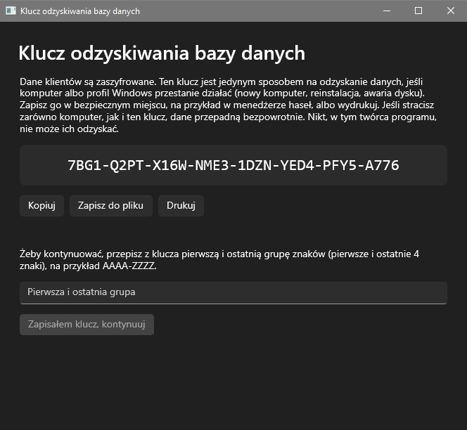
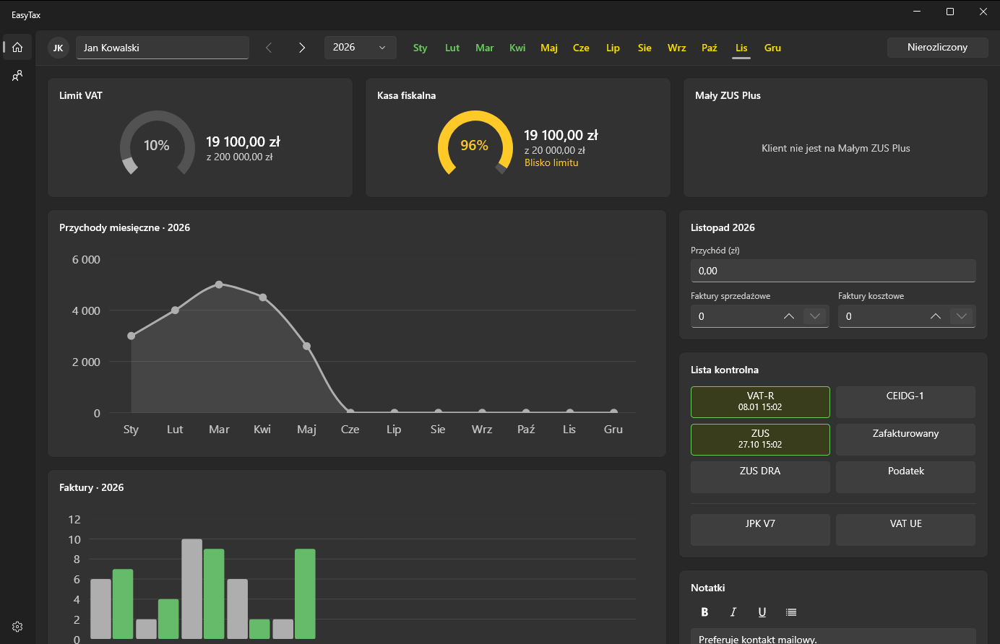
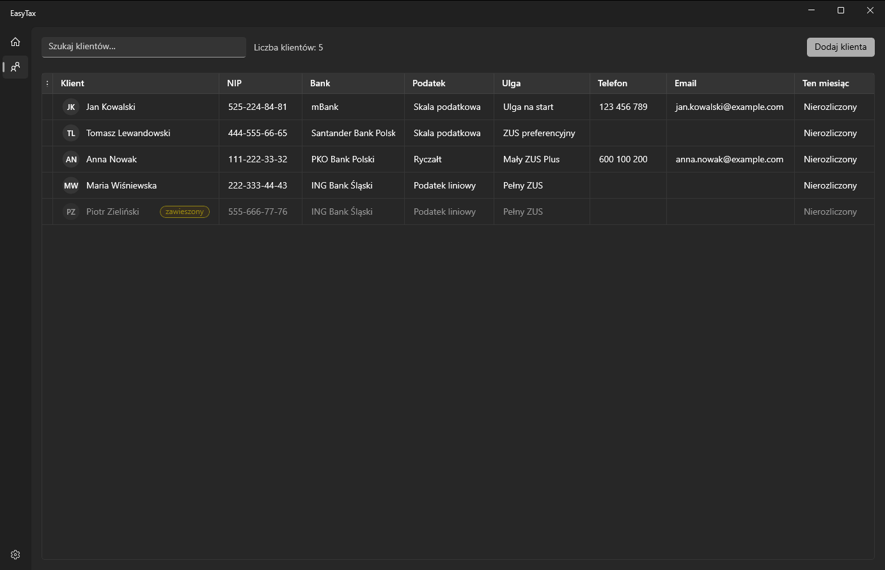
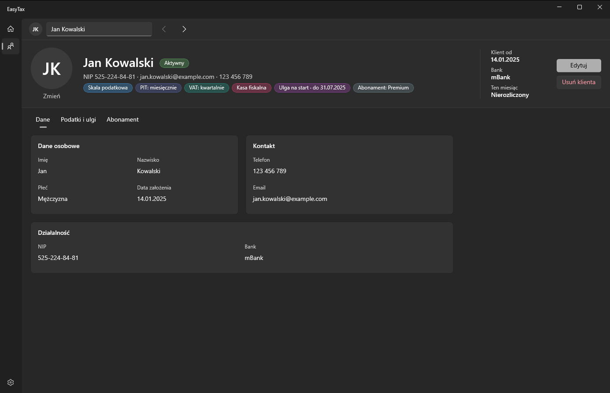
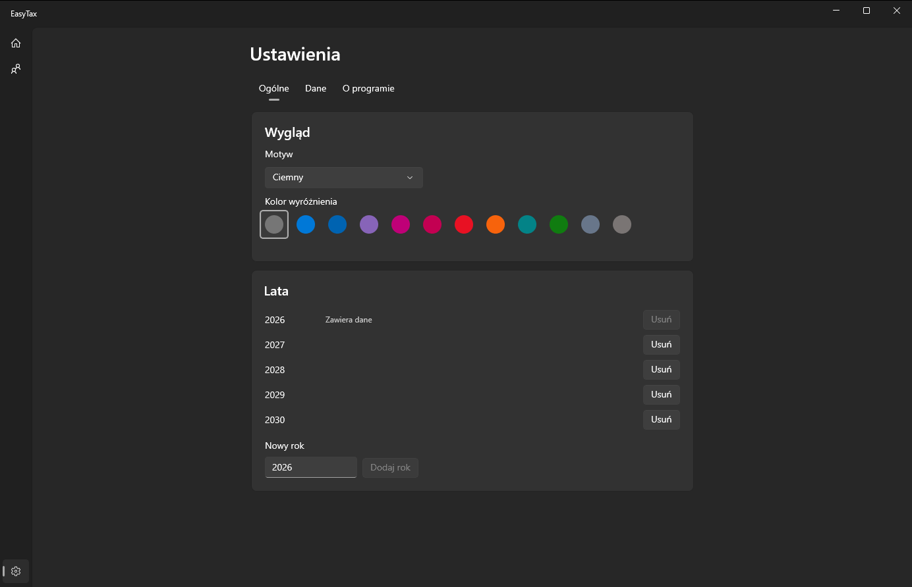
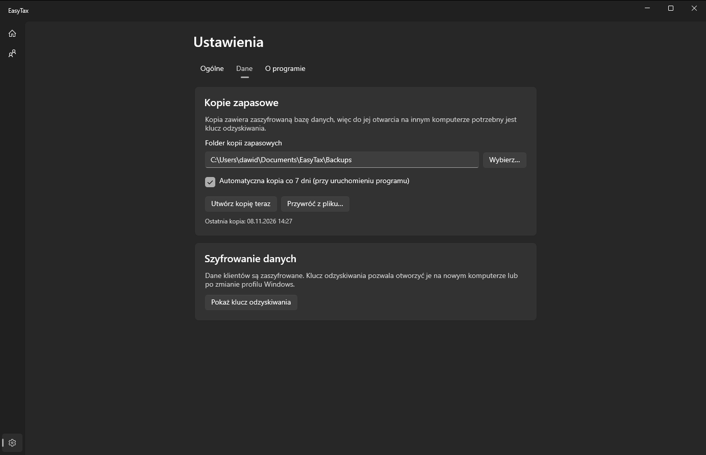

# EasyTax Dashboard – instrukcja

Program do prowadzenia klientów biura rachunkowego: pilnuje limitów, rozliczeń miesięcznych i list kontrolnych. Wszystkie dane są zapisane na Twoim komputerze i zaszyfrowane.

## Spis treści

1. [Instalacja](#1-instalacja)
2. [Pierwsze uruchomienie i klucz odzyskiwania](#2-pierwsze-uruchomienie-i-klucz-odzyskiwania)
3. [Układ programu](#3-układ-programu)
4. [Pulpit](#4-pulpit)
5. [Klienci](#5-klienci)
6. [Ustawienia](#6-ustawienia)
7. [Kopie zapasowe](#7-kopie-zapasowe)
8. [Skróty klawiaturowe](#8-skróty-klawiaturowe)
9. [Aktualizacje i odinstalowanie](#9-aktualizacje-i-odinstalowanie)

---

## 1. Instalacja

Wymagany jest Windows 10 (wersja 2004 lub nowsza) albo Windows 11, 64-bitowy. Pliki znajdziesz na stronie najnowszego wydania: <https://github.com/dawidbieniek/EasyTax-dashboard/releases/latest>

### Krok 1: zaufaj certyfikatowi (jednorazowo na każdym komputerze)

Program jest podpisany własnym certyfikatem, którego Windows jeszcze nie zna, więc bez tego kroku odmówi instalacji. Potrzebujesz uprawnień administratora.

**Sposób z skryptem (najprostszy):**

1. Pobierz do **jednego folderu** pliki `EasyTaxDashboard.cer` i `Install-Certificate.ps1`.
2. Kliknij `Install-Certificate.ps1` prawym przyciskiem myszy i wybierz **Uruchom za pomocą programu PowerShell**.
3. Potwierdź pytanie o uprawnienia administratora. Na końcu w oknie pojawi się komunikat `Trusted: …`.

**Sposób ręczny (bez skryptu):**

1. Kliknij dwukrotnie `EasyTaxDashboard.cer` i wybierz **Zainstaluj certyfikat…**
2. Wybierz **Komputer lokalny** i potwierdź pytanie o uprawnienia.
3. Wybierz **Umieść wszystkie certyfikaty w następującym magazynie** → **Przeglądaj…** → **Zaufane osoby** (*Trusted People*).
4. Zakończ kreator.

### Krok 2: zainstaluj program

Pobierz `EasyTaxDashboard.appinstaller`, otwórz go (dwukrotne kliknięcie) i kliknij **Zainstaluj**. Program pojawi się na liście aplikacji w menu Start.

> Jeśli instalator zgłasza, że aplikacja nie jest zaufana lub „nie można zweryfikować wydawcy”, krok 1 nie został wykonany poprawnie. Najczęstsza przyczyna: certyfikat trafił do magazynu *Bieżący użytkownik* zamiast *Komputer lokalny*, albo do innego magazynu niż *Zaufane osoby*.

---

## 2. Pierwsze uruchomienie i klucz odzyskiwania

Przy pierwszym starcie program pokazuje **klucz odzyskiwania**: kod złożony z grup po cztery znaki. Dane klientów są zaszyfrowane, a ten klucz jest **jedynym sposobem odzyskania ich** po awarii komputera, reinstalacji Windows albo przeniesieniu programu na inny komputer.

- Kliknij **Kopiuj**, **Zapisz do pliku** albo **Drukuj** i schowaj klucz w bezpiecznym miejscu (najlepiej wydrukowany, osobno od komputera).
- Aby przejść dalej, przepisz pierwszą i ostatnią grupę znaków (np. `7BG1-A776`) i kliknij **Zapisałem klucz, kontynuuj**. To sprawdza, że klucz został naprawdę zapisany. Zamknięcie okna bez tego kroku niczego nie zapisuje, a okno pojawi się przy następnym starcie.
- Klucz możesz później wyświetlić ponownie: **Ustawienia → Dane → Pokaż klucz odzyskiwania**.

Kto ma klucz razem z plikiem danych, może odczytać dane klientów, więc nie wysyłaj go mailem ani nie zostawiaj na pulpicie.

---

## 3. Układ programu

**Lewy pasek** przełącza ekrany: **Pulpit** (`1`), **Klienci** (`2`) i **Ustawienia** (`3`, ikona zębatki na dole).

**Górny pasek** (widoczny na Pulpicie i, częściowo, na stronie klienta):

- **Wybór klienta**: kliknij pole i zacznij pisać imię, nazwisko lub NIP. Strzałki obok przechodzą do poprzedniego i następnego klienta. Zawieszeni klienci się tu nie pojawiają.
- **Rok** i **miesiące** (Sty–Gru). Kolor miesiąca mówi, jak wygląda rozliczenie:
  - **zielony**: rozliczony,
  - **żółty**: nierozliczony,
  - **szary** i nieaktywny: miesiąc sprzed dołączenia klienta.

  Wybrany miesiąc jest podkreślony. Jeśli wybierzesz klienta, który dołączył później, program sam przesunie się na miesiąc jego dołączenia.
- **Rozliczony / Nierozliczony**: przełącznik dla wybranego miesiąca (zielony = rozliczony).

Program pamięta ostatnio wybranego klienta, rok i miesiąc.

---

## 4. Pulpit

Pulpit pokazuje wybranego klienta w wybranym miesiącu.

### Limity

Trzy wykresy kołowe pokazują, jak daleko klient jest od limitu:

| Limit | Wartość |
|---|---|
| Limit VAT | 200 000 zł (w roku dołączenia proporcjonalnie do liczby miesięcy) |
| Kasa fiskalna | 20 000 zł |
| Mały ZUS Plus | 120 000 zł |

Od **90%** wykres robi się **żółty** („Blisko limitu”), od **100%** **czerwony** („Limit przekroczony”). Po najechaniu na kwotę zobaczysz, z jakiego okresu liczony jest przychód. Jeśli klient nie ma kasy fiskalnej albo nie jest na Małym ZUS Plus, karta mówi o tym zamiast pokazywać wykres.

### Wykresy

**Przychody miesięczne** (linia) i **Faktury** (słupki: sprzedażowe i kosztowe) dla wybranego roku. Aktualizują się na bieżąco, gdy wpisujesz dane.

### Karta miesiąca

Wpisz **przychód** oraz liczbę **faktur sprzedażowych** i **kosztowych**. Wartość zapisuje się po wciśnięciu `Enter` albo wyjściu z pola. Dla miesięcy sprzed dołączenia klienta pola są wyłączone.

### Lista kontrolna

Kliknij pozycję, aby oznaczyć ją jako zrobioną. Zrobiona zmienia kolor na zielony i pokazuje datę wykonania. Kliknij ponownie, aby cofnąć.

- **Dla klienta (jednorazowo):** VAT-R, CEIDG-1, ZUS, Zafakturowany, ZUS DRA, Podatek.
- **Dla miesiąca (osobno w każdym miesiącu):** JPK V7, VAT UE.

### Notatki

Edytor z pogrubieniem, kursywą, podkreśleniem i listą punktowaną. Zapisuje się sam, chwilę po tym, jak przestaniesz pisać. Notatki są przypisane do klienta.

---

## 5. Klienci

### Lista

- Pole **Szukaj klientów…** przeszukuje imię i nazwisko, NIP, bank, telefon i e-mail.
- Kliknij nagłówek kolumny, aby posortować listę.
- Ostatnia kolumna, **Ten miesiąc**, pokazuje, czy klient jest rozliczony w **bieżącym miesiącu kalendarzowym**.
- **Jedno kliknięcie wiersza** otwiera klienta.
- **Prawy przycisk myszy** na wierszu: **Otwórz**, **Zawieś / Przywróć**, **Usuń…**
- Zawieszeni klienci są wyszarzeni i mają znaczek „zawieszony”.

### Dodawanie klienta

**Dodaj klienta** (lub `N`) otwiera formularz. Pola wymagane są sprawdzane po kliknięciu **Dodaj**, a błędy formatu (np. NIP, e-mail) pojawiają się już podczas pisania. NIP jest weryfikowany sumą kontrolną. Telefon, e-mail i zdjęcie są opcjonalne.

### Zawieszenie i usunięcie

- **Zawieś** używaj, gdy klient przestał z Tobą współpracować. Dane zostają, klient znika z wyboru na górnym pasku, a strona klienta pokazuje datę zawieszenia. Zawieszenie można cofnąć.
- **Usuń** kasuje klienta razem z danymi miesięcznymi i zdjęciem **bezpowrotnie**. Dane księgowe i podatkowe zwykle trzeba przechowywać przez okres wymagany przepisami (kilka lat), więc w razie wątpliwości zawieś, nie usuwaj. Program prosi o potwierdzenie, a domyślnym przyciskiem jest **Anuluj**.

Usunięty klient nie wróci też po przywróceniu starszej kopii zapasowej (program prowadzi o tym osobny rejestr).

### Strona klienta

U góry: zdjęcie (**Zmień** / **Usuń**), imię i nazwisko, status, dane kontaktowe i **kolorowe etykiety**, z których od razu widać, co klient ma: forma opodatkowania, częstotliwość PIT i VAT, kasa fiskalna, ulga (z datą końca) i abonament. Po prawej: data dołączenia, bank i rozliczenie w bieżącym miesiącu.

Poniżej trzy zakładki: **Dane**, **Podatki i ulgi**, **Abonament**.

- **Edytuj** (`E`) przełącza strony w tryb formularza. **Zapisz** (`Ctrl+S`) zapisuje zmiany, **Anuluj** (`Esc`) je odrzuca. Podczas edycji nie można zmienić klienta na górnym pasku, a próba opuszczenia strony z niezapisanymi zmianami pyta, czy zapisać, odrzucić czy zostać.
- Data zakończenia ulgi jest liczona na żywo na podstawie wybranej ulgi i daty dołączenia.
- Zdjęcie jest przycinane do kwadratu i zmniejszane. Zdjęcie zrobione telefonem „na boku” może pojawić się obrócone.

---

## 6. Ustawienia

Ustawienia są podzielone na trzy zakładki.

### Ogólne

- **Wygląd**: motyw (**Systemowy**, **Jasny**, **Ciemny**) i **kolor wyróżnienia**. Pierwsza kropka to kolor ustawiony w Windows, pozostałe to paleta Windows. Kolor wpływa na przyciski, podkreślenia i wykresy.
- **Lata**: lata dostępne na górnym pasku. Dodaj rok (2000–2100) albo usuń rok, w którym nie ma żadnych danych. Rok z danymi jest oznaczony „Zawiera dane” i nie można go usunąć.

### Dane

- **Kopie zapasowe**: folder, automatyczna kopia, ręczne tworzenie i przywracanie (szczegóły w [rozdziale 7](#7-kopie-zapasowe)).
- **Szyfrowanie danych**: **Pokaż klucz odzyskiwania** wyświetla klucz z pierwszego uruchomienia, z przyciskiem **Kopiuj**.

### O programie

Numer wersji i link **Licencje składników zewnętrznych** (licencje bibliotek, z których zbudowany jest program).

---

## 7. Kopie zapasowe

Kopia to jeden plik `.zip` z zaszyfrowaną bazą danych. Domyślny folder to `Dokumenty\EasyTax\Backups`; możesz go zmienić przyciskiem **Wybierz…** (może to być też folder sieciowy).

- **Automatyczna kopia**: przy uruchomieniu programu, jeśli ostatnia kopia jest starsza niż 7 dni. Po zakończeniu pojawia się powiadomienie. Kopie nie są usuwane automatycznie.
- **Utwórz kopię teraz**: kopia na żądanie. Pod przyciskami widać datę ostatniej kopii.
- **Przywróć z pliku…**: wskaż plik kopii. Program pokaże datę kopii i poprosi o potwierdzenie. Przed zastąpieniem danych zapisuje kopię obecnego stanu (plik z dopiskiem `prerestore`), a po przywróceniu **uruchamia się ponownie**.

Kopia otwiera się na innym komputerze dopiero po wpisaniu **klucza odzyskiwania** z komputera, na którym powstała. Dlatego klucz i kopie przechowuj osobno, ale oba w bezpiecznym miejscu.

---

## 8. Skróty klawiaturowe

Skróty jednoklawiszowe nie działają, gdy kursor jest w polu tekstowym. Wciśnij `Esc` lub kliknij puste miejsce, aby z niego wyjść. Skróty z `Ctrl` i `Alt` działają zawsze. Po najechaniu na przycisk zobaczysz jego skrót w podpowiedzi.

| Gdzie | Klawisze | Działanie |
|---|---|---|
| Wszędzie | `1` `2` `3` | Pulpit / Klienci / Ustawienia |
| Górny pasek | `/` lub `Ctrl+F` | Wybór klienta |
| Górny pasek | `Alt+←` `Alt+→` | Poprzedni / następny klient |
| Górny pasek | `,` `.` lub `←` `→` (w polu roku) | Poprzedni / następny miesiąc |
| Górny pasek | `Shift+,` `Shift+.` | Poprzedni / następny rok |
| Górny pasek | `A` | Rozliczony / nierozliczony |
| Pulpit | `I` `S` `C` | Pole przychodu / faktur sprzedażowych / faktur kosztowych |
| Pulpit | `N` | Notatki |
| Pulpit | `R` `E` `U` `F` `D` `T` | VAT-R, CEIDG-1, ZUS, Zafakturowany, ZUS DRA, Podatek |
| Pulpit | `J` `V` | JPK V7, VAT UE |
| Klienci | `/` lub `Ctrl+F` | Szukaj |
| Klienci | `N` lub `Ctrl+N` | Nowy klient |
| Klienci | `Enter` / `Delete` | Otwórz / usuń zaznaczonego klienta |
| Strona klienta | `E` / `Delete` | Edytuj / usuń |
| Strona klienta (edycja) | `Ctrl+S` / `Esc` | Zapisz / anuluj |

---

## 9. Aktualizacje i odinstalowanie

**Aktualizacje** pobierają się same. Przy każdym uruchomieniu Windows sprawdza, czy jest nowa wersja, i pobiera ją w tle. Program nie może zastąpić samego siebie, gdy działa, więc nowa wersja zacznie działać **dopiero przy kolejnym uruchomieniu**: po wydaniu aktualizacji zamknij program i otwórz go ponownie (czasem dwa razy). Bez internetu program po prostu się uruchamia.

**Odinstalowanie usuwa dane programu.** Kopie zapasowe w `Dokumenty\EasyTax\Backups` zostają. Zanim odinstalujesz program, sprawdź w **Ustawienia → Dane**, czy istnieje świeża kopia, i upewnij się, że masz klucz odzyskiwania. Bez niego kopii nie otworzysz.

**Coś nie działa?** Jeśli program nie może się uruchomić, pokazuje okno z opisem problemu i miejscem pliku dziennika (jeden plik na dzień). Przekaż go razem z opisem.
